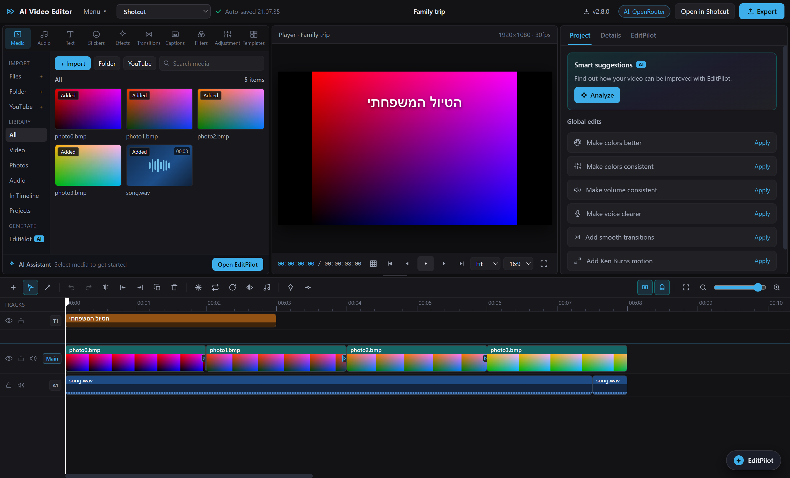
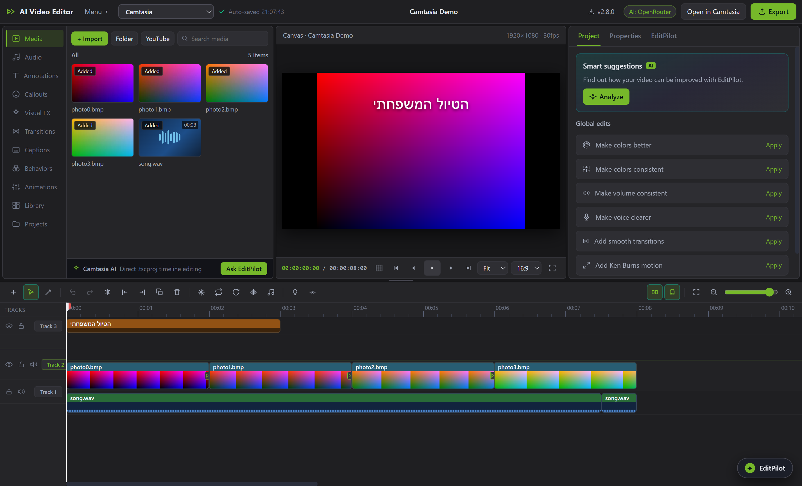

# AI Video Editor 🎬

**[עברית](#עברית) · [English](#english)**

Chat with an AI that edits your video project for you: *"take all the photos from this folder, 4 seconds each, slow zoom, fade transitions, and put the song from Downloads under the whole thing"*.



<details>
<summary>Camtasia Mode Screenshot (v2.8.0)</summary>



</details>

---

## עברית

תוכנה לווינדוס בסביבת עריכה מלאה במצב כהה (Dark Mode) עם ציר זמן אינטראקטיבי רב-ערוצי, תצוגה מקדימה חיה, ספריית מדיה, עורך מאפיינים ו-**EditPilot** — עוזר ה-AI שעורך עבורכם את הפרויקט ישירות בתוכנת העריכה.

> **דרישה מוקדמת — תוכנת עריכת וידאו קיימת:** התוכנה **אינה** מרנדרת או מייצאת קובץ MP4 סופי בעצמה. היא עורכת ישירות את קובץ הפרויקט (ב-CapCut / Camtasia / Shotcut / OpenShot) או כותבת קובץ ייבוא (ל-Premiere Pro / DaVinci Resolve / Final Cut Pro / Kdenlive / VEGAS / Filmora), ולאחר מכן פותחים או מרנדרים את הסרטון הסופי בתוכנת העריכה המותקנת במחשב.

### מה חדש ב-v2.8.0 (כולל כל יכולות v2.2.0–v2.7.0)
- **תמיכה ישירה מלאה ב-TechSmith Camtasia (`.tscproj`):** פתיחה, שמירה, זיהוי אוטומטי של Camtasia בווינדוס, חיפוש פרויקטים בתיקיית `Documents\Camtasia` ועריכה ישירה של מסלולים, Callouts, אנימציות, מעברים ושמע ב-`.tscproj`.
- **ממשק שמשתנה אוטומטית לפי התוכנה הנבחרת:** בוחר תוכנה מהיר בסרגל העליון שמחליף בזמן אמת את עיצוב הסביבה בהתאם לתוכנת העריכה — כולל מצב **Camtasia** ייעודי (סרגל כלים אנכי משמאל עם *Annotations / Behaviors / Animations / Visual FX*, צבעי Camtasia הירוקים, תצוגת **Canvas**, לוח **Properties**, כותרות **Track 1/2/3** וסמן Playhead דו-צבעי) וכן התאמות צבע/שמות ל-CapCut, Premiere Pro, DaVinci Resolve, Shotcut, OpenShot, Kdenlive, VEGAS ו-Filmora.
- **כפתור עדכון קבוע, הורדה מיוטיוב ורינדור Markdown בצ'אט (מ-v2.7.0):** כפתור גרסה ועדכונים קבוע בסרגל העליון עם הורדה והתקנה בלחיצה מ-GitHub Releases, הורדת שירים/סרטונים מיוטיוב בצ'אט EditPilot ובספריית המדיה (`download_youtube`), ותצוגת טבלאות RTL/LTR נקייה בצ'אט.
- **מראה CapCut Desktop וגרירה ושחרור מלאה (מ-v2.2.0–v2.6.0):** סרגל 10 לשוניות, אזור Overlay פתוח, כרטיס Cover, סרגל זום לוגריתמי, גרירה מספריית המדיה ומ-Windows Explorer, תיקיות/קבצים בצ'אט ומעבר אוטומטי בין ספקי AI.

### התקנה
1. הורידו את `AIVideoEditor-Setup-<גרסה>.exe` מ-[Releases](https://github.com/dor2500/ai-video-editor/releases/latest) והריצו. לא צריך הרשאות מנהל.
2. בפתיחה הראשונה בוחרים שירות AI ומזינים מפתח API. המפתחות נשמרים מוצפנים (Windows DPAPI) רק במחשב שלכם.

| שירות | מחיר | מפתח |
|---|---|---|
| **Gemini (Google)** — ברירת מחדל | חינם למודלי Flash | [aistudio.google.com](https://aistudio.google.com/apikey) |
| **Groq** | חינם (מגבלה יומית) | [console.groq.com](https://console.groq.com/keys) |
| **OpenRouter** | חינם למודלים עם `:free` | [openrouter.ai](https://openrouter.ai/settings/keys) |
| **Cerebras** | חינם (מכסה יומית) | [cloud.cerebras.ai](https://cloud.cerebras.ai/) |
| **Mistral** | חינם (מסלול Experiment) | [console.mistral.ai](https://console.mistral.ai/api-keys) |
| **Claude (Anthropic)** | בתשלום, הכי מדויק | [console.anthropic.com](https://console.anthropic.com/settings/keys) |

> **מעבר אוטומטי:** אם שמרתם מפתחות לכמה שירותים ונגמרת המכסה או הקרדיט באחד מהם, התוכנה עוברת לבד לשירות הבא וממשיכה בבקשה.
> אפשר **לגרור** תמונות, סרטונים, שירים או תיקייה לחלון הצ'אט. כשיוצאת גרסה חדשה מופיע כפתור עדכון.

> במסלולים החינמיים יש מגבלת בקשות. כל עריכה צורכת כמה קריאות, אז אם נגמרת המכסה של שירות אחד, אפשר לעבור לשירות אחר בהגדרות. מודלים חינמיים טועים יותר מ-Claude.

יש גם גרסה ניידת (`portable.exe`) שלא דורשת התקנה.

### תוכנות עריכה נתמכות
| תוכנה | איך זה עובד |
|---|---|
| **CapCut** | עריכה ישירה של הפרויקט. אפקטים, מעברים, אנימציות, פילטרים ופונטים נלקחים מהמטמון של CapCut במחשב שלכם |
| **Camtasia** | עריכה ישירה של קובץ ה-`.tscproj` + התאמת ממשק התוכנה לסגנון Camtasia (פאנלים, סרגל כלים משמאל, צבעים ו-Tracks) |
| **Shotcut** | עריכה ישירה של קובץ ה-`.mlt` |
| **OpenShot** | עריכה ישירה של קובץ ה-`.osp` |
| **Adobe Premiere Pro** | התוכנה כותבת קובץ `.xml` (Final Cut Pro 7 XML) ← File → Import |
| **DaVinci Resolve** | קובץ `.fcpxml` (וגם `.otio`) ← File → Import → Timeline |
| **Final Cut Pro** | קובץ `.fcpxml` ← File → Import → XML |
| **Kdenlive** | קובץ `.otio` ← File → Import → OpenTimelineIO |
| **VEGAS Pro / Filmora** | קובץ `.xml` (FCP7) + `.edl` |
| **כל תוכנה אחרת** | כל הפורמטים יחד: `.fcpxml`, `.xml`, `.otio`, `.edl`, `.mlt` |

רוב התוכנות (Premiere, Resolve, Vegas…) לא מאפשרות לערוך את קובץ הפרויקט שלהן מבחוץ בבטחה. לכן התוכנה שומרת ציר זמן משלה, ובכל שינוי כותבת מחדש קובץ ייבוא שהתוכנה פותחת.

### מה אפשר לבקש
- להוסיף תמונות או סרטונים (קבצים או תיקייה שלמה), לטראק הראשי או כשכבה עליונה
- להוסיף מוזיקה לכל אורך הסרטון (עם לולאה, חיתוך, עוצמה ו-fade)
- להוסיף טקסטים וכותרות (צבע, גודל, מיקום, מסגרת, רקע, פונט)
- להזיז, לקצר, לחתוך, למחוק ולסדר מחדש
- לשנות גודל, מיקום, סיבוב, שקיפות, מהירות ועוצמה
- להשתיק טראק, להוסיף מעברים, אנימציות כניסה ויציאה, זום ופאן (Ken Burns), פילטרים ואפקטים (ב-CapCut), ולשנות יחס מסך
- ה-AI יכול גם **להסתכל על התמונות** כדי לבחור ולסדר אותן לפי התוכן

כל בקשה היא צעד אחד של ↶ ביטול. הגיבויים נשמרים ב-`%APPDATA%\AIVideoEditor\backups`.

> ⚠️ ב-CapCut, Camtasia, Shotcut ו-OpenShot צריך לסגור את התוכנה בזמן העריכה, אחרת היא דורסת את השינויים. האפליקציה מציעה לסגור אותה בשבילכם.

---

## English

A Windows desktop video editing studio in permanent Dark Mode featuring a media bin, live preview stage, property inspector, interactive multi-track timeline, and **EditPilot** — an AI assistant that edits your project directly in your video editor.

> **Requirement — Existing Video Editor:** This app does **not** render or export the final MP4 video file on its own. You need an existing video editor installed (direct project editing for CapCut, Camtasia, Shotcut, and OpenShot; or import files generated for Premiere Pro, DaVinci Resolve, Final Cut Pro, Kdenlive, VEGAS Pro, or Filmora) to open and render your finished video.

### Highlights (v2.8.0 + v2.2.0–v2.7.0)
- **Direct TechSmith Camtasia Support (`.tscproj`) & Adaptive Workspace Skins:** Full `.tscproj` JSON reader/writer, automatic detection of Windows Camtasia installations and `Documents\Camtasia` projects, plus a top-bar editor switcher that transforms the UI to match the selected editor — including an authentic **Camtasia** mode (vertical left tool rail with *Annotations / Callouts / Visual FX / Behaviors / Animations*, `#76b82a` green accent, **Canvas**, **Properties**, **Track 1/2/3** headers, green/red playhead) as well as tailored palettes/labels for CapCut, Premiere Pro, DaVinci Resolve, Shotcut, OpenShot, Kdenlive, VEGAS Pro, and Filmora.
- **GitHub Releases Updater, YouTube Downloads & Chat Markdown (v2.7.0):** Always-visible Releases button with one-click installer download, YouTube audio/video downloads directly in EditPilot (`download_youtube`) and the Media/Audio Bin, plus clean RTL-aware Markdown/table rendering in chat.
- **CapCut Layout Parity, Full Drag & Drop & Multi-Provider Fallback (v2.2.0–v2.6.0):** Balanced 3-pane layout, open Overlay drop canvas, Cover badge, logarithmic zoom slider, Media Bin & Windows Explorer drag-and-drop, Stage gizmo editing, Stickers/`.srt`/Adjustments/Templates, and automatic quota fallback across AI providers.

### Install
Download `AIVideoEditor-Setup-<version>.exe` from [Releases](https://github.com/dor2500/ai-video-editor/releases/latest). It installs per user and needs no admin rights. A portable exe is also attached. On first start, pick an AI service and paste its API key. Keys are stored encrypted with Windows DPAPI. Free services: **Gemini** Flash models (the default), **Groq**, **OpenRouter** `:free` models, **Cerebras** and **Mistral** (Experiment plan). Paid: **Claude**. Free tiers have request limits, and an edit takes several model calls. When one service runs out of quota or credit, the app switches automatically to the next service you have a key for. Files and folders can be dragged into the chat, and the app shows a button when a new release is out.

### Editors
- **Direct editing:** CapCut (draft JSON), Camtasia (`.tscproj`), Shotcut (`.mlt`), OpenShot (`.osp`).
- **Import files**, rewritten on every change: Premiere Pro (FCP7 `.xml`), DaVinci Resolve (`.fcpxml` / `.otio`), Final Cut Pro (`.fcpxml`), Kdenlive (`.otio`), VEGAS / Filmora (`.xml` + `.edl`), and "other" (all formats at once).

CapCut effect, transition, animation, filter and font names come from CapCut's own local cache and from effects already used in your drafts. No third-party effect catalog is bundled.

### Build
Requirements: Windows, .NET SDK 10+, and Visual Studio Build Tools with the C++ workload (for the NativeAOT installer).
```powershell
./build.ps1 -Version 2.0.0     # app + self-test + dist\AIVideoEditor-Setup-2.0.0.exe
dotnet run --project tests/SelfTest -- --media "C:\photos" --audio "C:\song.mp3" --capcut "<a CapCut draft folder to COPY>"
```

### Layout
```
src/AIVideoEditor/
  Core/CapCut/     CapCut draft engine + catalog from CapCut's cache
  Core/Timeline/   editor-neutral timeline model and editing operations
  Core/Formats/    Shotcut MLT, OpenShot, FCPXML, FCP7 XML, OTIO, EDL
  AI/              tool definitions, agent loop; providers: Claude (Anthropic SDK), Gemini (REST),
                   OpenAI-compatible (Groq, OpenRouter, Cerebras, Mistral)
  wwwroot/ui.html  chat UI (WebView2)
installer/Setup/   NativeAOT per-user installer
tests/SelfTest/    engine and format tests (no AI calls)
legacy/python-prototype/   first version (Python + pywebview, CapCut only)
```

### Notes and limits
- Only the CapCut engine has been checked against real project files (it edits copies of real drafts in the self-test). Writers for the other editors follow each format's published structure and pass the round-trip and parse tests, but have not been opened in every editor yet. Please open an issue if an import fails.
- Transitions outside CapCut: Cross Dissolve, Dip to Black, Dip to White, Wipe. Animations outside CapCut: fade in and fade out.
- Media duration and size are read through Windows' property system. A file Windows has no codec for (some MKV or HEVC files) may fail to load.

Thanks to [pyJianYingDraft / pyCapCut](https://github.com/GuanYixuan/pyJianYingDraft) for documenting the CapCut draft format. No code from them is included in the .NET app.

MIT License.
